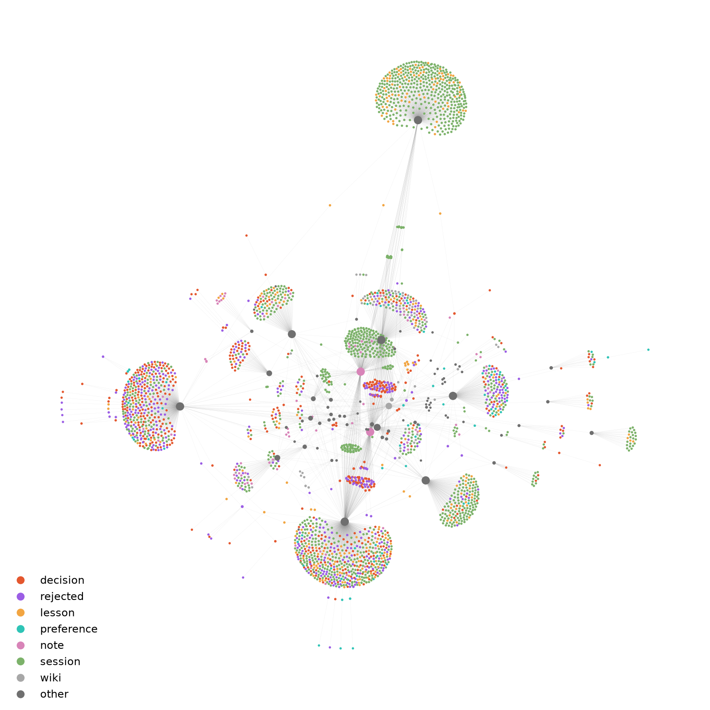
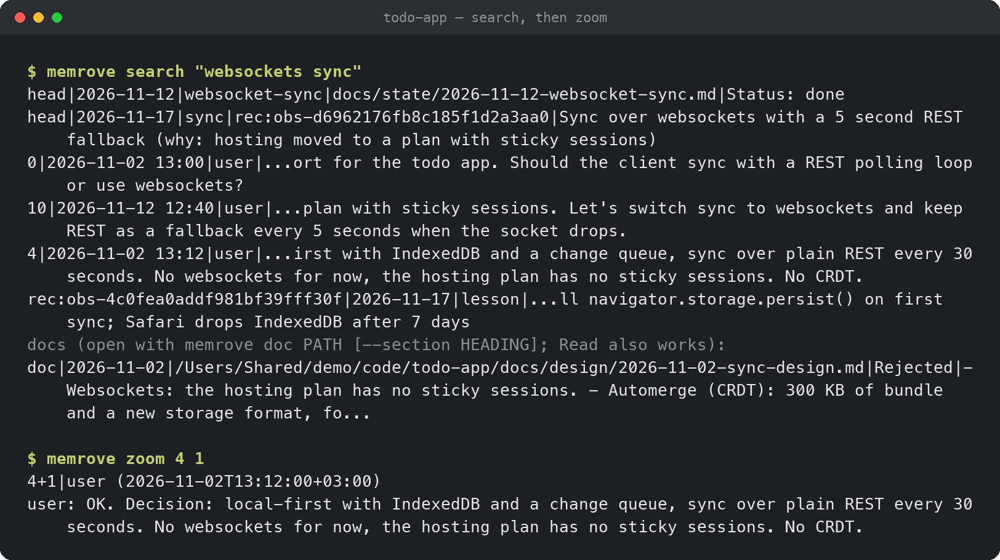
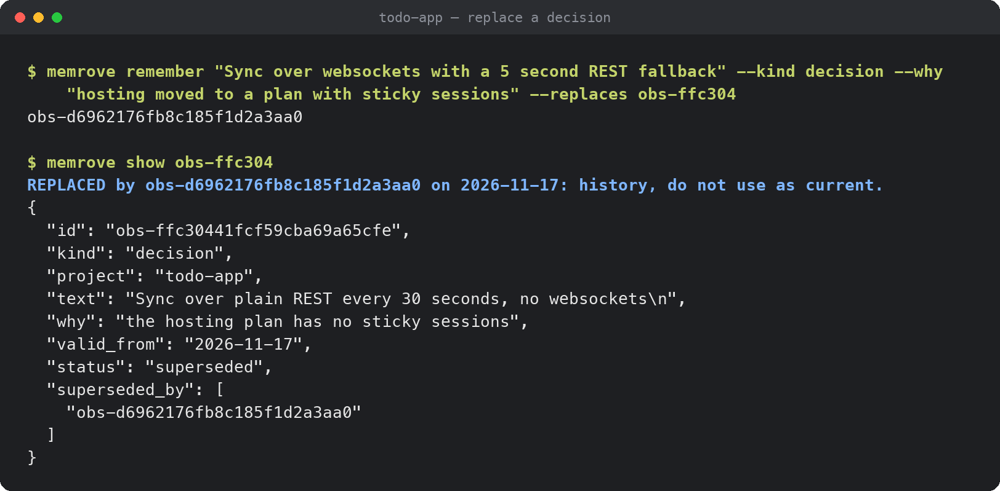
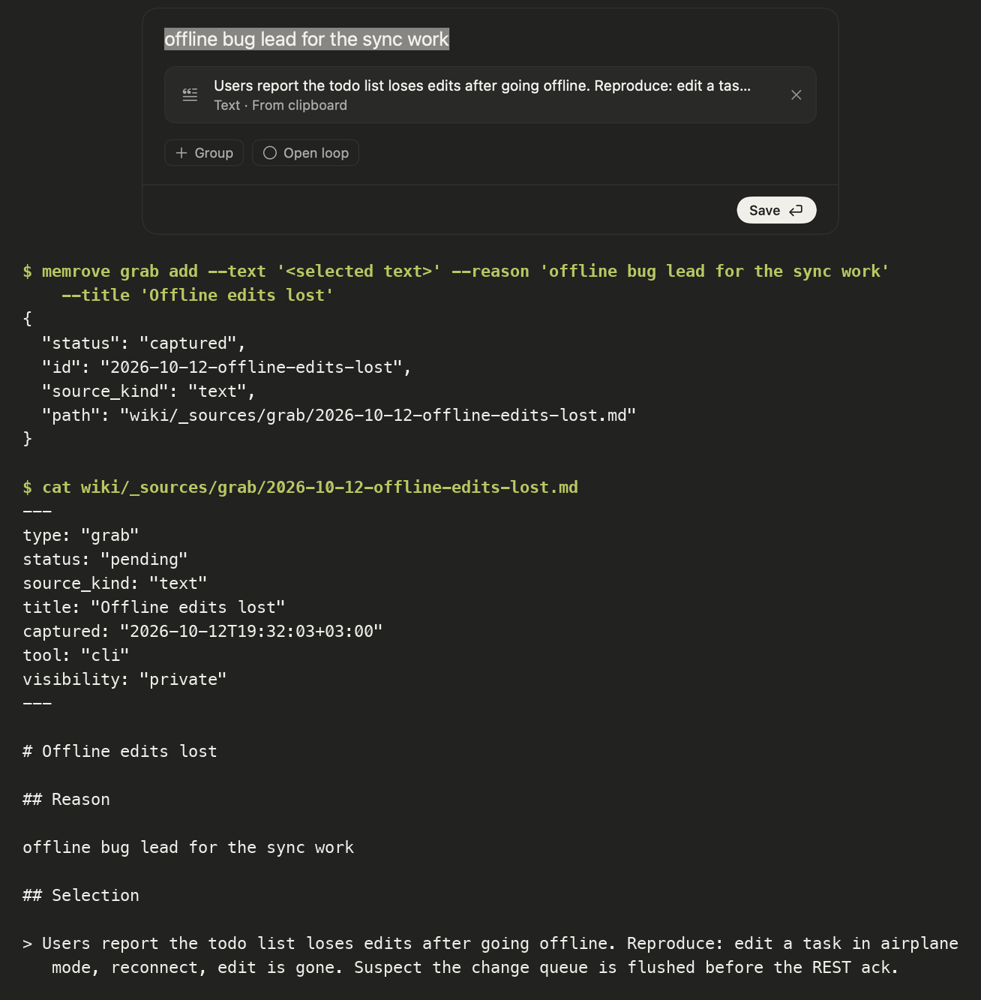
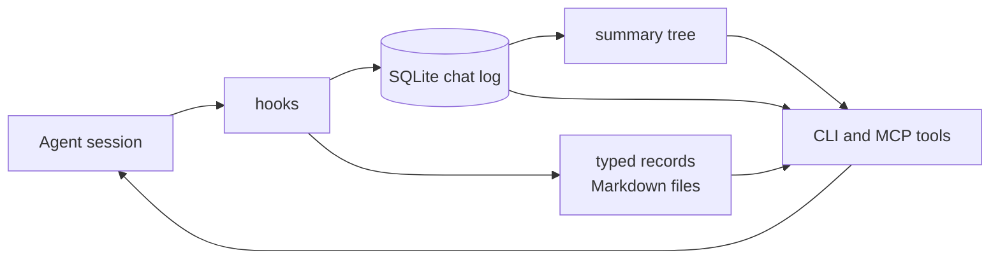

# memrove

[](https://github.com/ecyx00/memrove/actions/workflows/v3.yml)

**Long-term memory for AI coding agents. Local, plain files, no server.**

A new agent session starts with no memory of the last one, so you brief it again. memrove keeps every message of every session, the decisions you made and the reasons for them. The next session reads its memory and continues the work.

It works with Claude Code and Codex. The command-line tool is `memrove`.



## What you get

- **Every message, kept unchanged.** Hooks record each session into one SQLite file. Search is full-text (FTS5, BM25) over messages, records and your project docs.
- **Decisions with their reasons.** `memrove remember` saves a `decision`, `rejected`, `lesson`, `preference` or `note` with its `why`.
- **History that stays honest.** A new record can replace an old one. The old record stays in the store and is marked `REPLACED`, so an agent does not act on a stale decision.
- **A map of the whole history.** A summary tree lets an agent start from one line and open it down to the original messages.
- **The agent pulls, memrove does not push.** A session starts with a short note and your standing rules. The agent searches the rest when it needs it.
- **Your data stays with you.** Records are Markdown files with `[[links]]` in a folder you choose. The engine uses the Python standard library only.

## Quick start

Requires Python 3.11 or newer. macOS is the tested platform.

```sh
git clone https://github.com/ecyx00/memrove && cd memrove
python3 scripts/install_v3.py --vault ~/memory --plan   # show what the install changes
python3 scripts/install_v3.py --vault ~/memory          # install
python3 ~/memory/memrove.py doctor                      # check
```

Open the vault folder (`~/memory` here) in a new Claude Code or Codex session. In Codex, trust the new hooks with `/hooks`.

The install writes into the vault only. Add `--global` to connect memrove to every project on the machine and to put the `memrove` command in `~/.local/bin`. `--global --uninstall` removes both. The installer makes a backup of each file it changes.

## Use

The examples use the `memrove` command. Without `--global`, type `python3 ~/memory/memrove.py` in its place.

Save a decision, then find it in a later session:

```sh
memrove remember "The API uses SQLite, not Postgres" --kind decision --why "one file, no server to operate"
memrove search "sqlite postgres"
```

```
rec:obs-40e269a159a22f962865f4f9|2026-11-17|decision|The API uses SQLite, not Postgres
```



Replace it when the decision changes. The old record is kept and marked:

```sh
memrove remember "The API moved to Postgres" --kind decision --why "two writers now" --replaces obs-40e269
```



| Command | What it does |
| --- | --- |
| `memrove search "<words>"` | Messages, records and docs in one ranked list |
| `memrove show <id>` | One record in full, with its links |
| `memrove wake` | The map of the chat history, one line per part |
| `memrove zoom <id> <n>` | Open a map line down to its messages |
| `memrove remember "<text>" --kind … --why …` | Save a record |
| `memrove brief "<topic>"` | The reading list of a topic: its docs and its live decisions |
| `memrove card --did … --next …` | Leave a handoff card for the next session |
| `memrove grab add` | Capture text, a screenshot or a link (⌃⌥B on macOS, local OCR) |
| `memrove backup --dest <dir>` | Copy the vault and the state into an empty folder |
| `memrove doctor` | Health of the hooks and the background writers |

`memrove --help` lists all commands.



## How it works



1. **Hooks** in Claude Code and Codex write each message to the chat log. Adapters for Hermes, OpenCode and OMP are in `template/.claude/scripts/`.
2. **The summary tree** is built over the log by a small model (Claude Haiku, through your Claude Code login). Set `MEMROVE_NO_LLM=1` to turn the Haiku calls off. Search and records work without them.
3. **Typed records** are Markdown files in the vault. Links between them are `[[links]]`, so Obsidian's graph view or `memrove graph` shows the memory.
4. **The agent reads** through the CLI. The `mods/memrove-chat` plugin also gives Claude Code the model tools `zoom`, `date` and `project` (`claude --plugin-dir mods/memrove-chat`).

A record can cite the message it came from, and the code checks the quote before it saves. A reader other than Claude Code, Codex or your own terminal sees only the records its tier allows (`MEMROVE_READER`).

## Configuration

| Setting | Use |
| --- | --- |
| `--python EXE` (installer) | The interpreter that the hooks and the `memrove` wrapper use |
| `--workspace-root DIR` (installer) | A folder whose direct subfolders are separate projects. Repeatable |
| `MEMROVE_DOC_REPOS` | `:`-separated repo folders or globs (`~/Projects/*`). Search reads their `docs/{state,audits,research,design,handoff,decisions}` |
| `MEMROVE_NO_LLM=1` | No Haiku calls |
| `MEMROVE_READER=local\|paid\|free` | Set the reader tier by hand, for a script or another agent tool |

To update, `git pull` and run `install_v3.py` again with the same options. It writes only the files that changed.

## Evaluation

The test is a job: can an agent in a new session continue the work with no new brief? The set has 136 questions in 5 types (why a decision was made, current state, tried and rejected, real prompts, questions with no answer). The agent answers with the production tools and a model grades each answer against key facts.

| Measure | Result |
| --- | --- |
| Weighted answer accuracy, 55 graded items | 0.662 (95% interval 0.538 to 0.787). The target is 0.90 |
| Tried-and-rejected questions | 11 of 11 correct |
| State questions | 5 of 11 correct |
| Past-reference detector, held out | precision 0.931, recall 0.771 |

Measured and not shipped:

- BM25 with a dense embedder: at best 38 of 60, against 41 of 60 for BM25 alone.
- Cross-encoder reranking: fewer correct top results, about 10 s per query, 3.8 GB of memory.
- Automatic "this replaces that" marks from a model: precision 0.40 to 0.60 against a gate of 0.90. A replacement is always an explicit `--replaces`.

The harnesses for the public sets LongMemEval-S and LoCoMo are in `bench/`.

## Limits

- Answer accuracy is below the target: 0.662 against 0.90.
- The evaluation uses the author's private chats. Only the method and the numbers are public.
- The samples are small: most per-type results have 11 graded items.
- Tested on macOS. Linux is in the CI matrix. Windows code paths exist and are not tested.

## Development

```sh
python3 scripts/test_parallel.py   # offline test suite, no network and no model calls
```

## License

MIT, see `LICENSE`.
