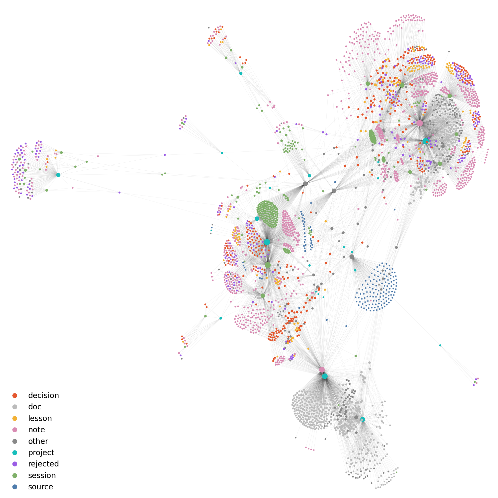
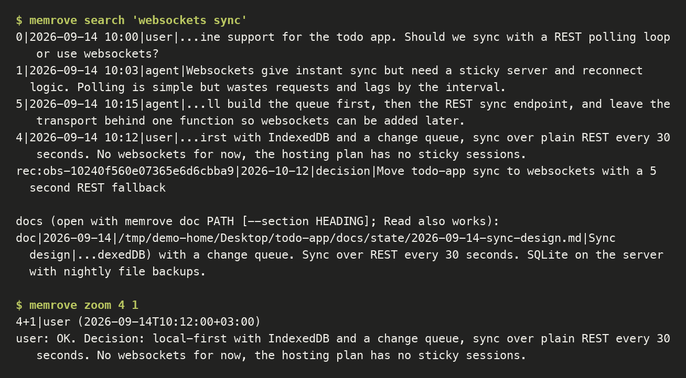
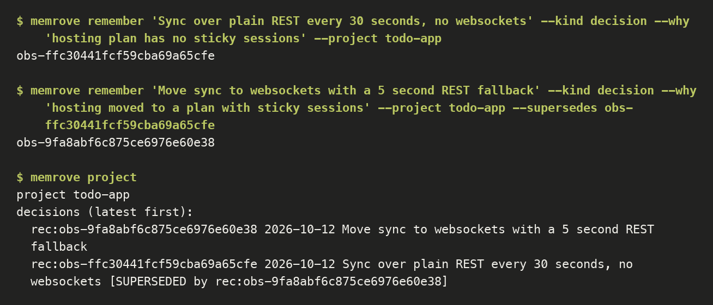
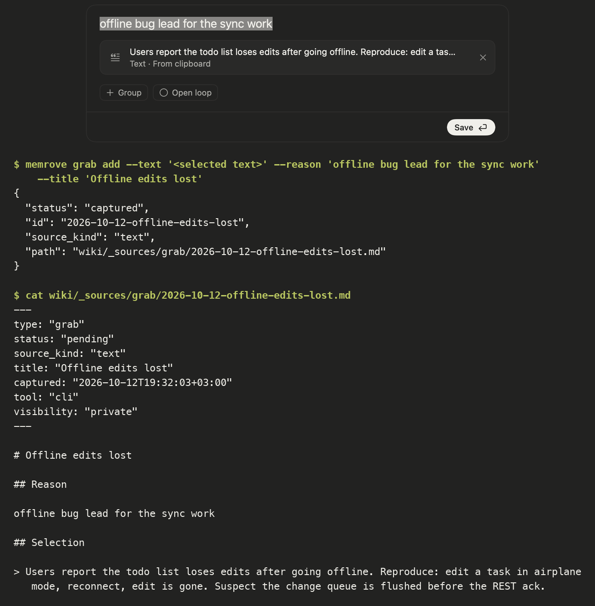
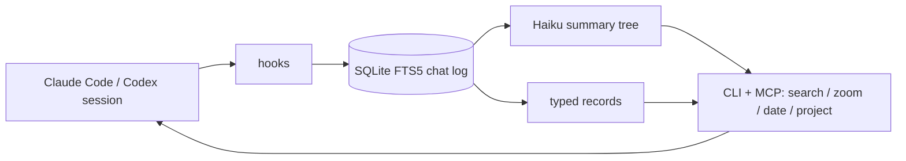

# memrove

Local cross-session memory for Claude Code and Codex. It stores every chat message verbatim, builds a summary tree over them, and lets an agent rove through its memory on demand. The command-line tool is `memrove`.



Memory graph of a real install, labels removed. Nodes are notes, edges are `[[links]]`, colors are note kinds.

## What it is

- **Verbatim chat log.** Every user and assistant message is kept unchanged in SQLite, indexed with FTS5 and ranked with BM25.
- **Summary tree.** Haiku summarises the log into a tree of nodes. Agents navigate it with three tools: `search` (BM25 over messages, records and docs), `zoom(id, n)` (open a node or message) and `date(id)` (when a message was written). Nothing is pushed into the agent's context by default; the agent pulls what it needs.



- **Typed records.** `memrove remember` stores a `decision`, `rejected`, `lesson`, `preference` or `note` with a `why` and an optional `supersedes` link. A superseded record stays in the store and is marked as replaced.



- **MCP tools and a CLI.** The `mods/memrove-chat` Claude Code plugin registers `zoom`, `date` and `project` as model tools. The same functions are available as `memrove search`, `memrove zoom`, `memrove project`, `memrove remember`, `memrove doctor` and others.
- **Grab.** Quick capture (⌃⌥B) of text, screenshots or links into memrove memory, with local Vision OCR. Commands: `memrove grab add|process|install`.



- **Hooks.** Hook scripts for Claude Code and Codex ingest sessions, add a short past-reference hint, and keep the index fresh. Hermes, OpenCode and OMP adapters are in `template/.claude/scripts/`.
- **Grab.** A macOS panel (Swift source shipped with the installer) captures a page, a selection or a note with one key into the wiki sources. Commands: `memrove grab add|process|install`.
- **Writer heartbeat.** Each background writer (chat compactor, session cards, threads) writes `<state>/heartbeat/<writer>.json` after every run. `memrove doctor` reports a chat-driven writer with no heartbeat 24 hours after first use, so a silent writer does not go unnoticed.

## Architecture



The engine uses the Python standard library only. State lives in one directory (`--state`); the vault holds the installed scripts. The `memrove-chat` plugin is TypeScript and only drives the CLI.

## Install

Requires Python 3.11 or newer. macOS is the tested platform.

```sh
git clone <this repo> memrove && cd memrove
python3 scripts/install_v3.py --vault /path/to/vault --plan   # show what would change
python3 scripts/install_v3.py --vault /path/to/vault          # install
python3 /path/to/vault/memrove.py doctor                        # check
```

Open the vault folder in a new Claude Code or Codex session. In Codex, review and trust the new hooks with `/hooks`. For the `zoom`, `date` and `project` model tools in Claude Code, load the plugin in `mods/memrove-chat` (`claude --plugin-dir mods/memrove-chat`); its options are in `mods/memrove-chat/README.md`. Update with `memrove.py update`, undo with `memrove.py rollback`. The engine needs no accounts, API keys or servers. `install_v3.py` backs up what it touches and writes no global settings unless `--global` is given.

Installer options: `--python EXE` picks the interpreter baked into the hooks and the `memrove` wrapper (the installer warns when the running python looks like conda or a venv, which breaks when that environment goes away); `--workspace-root DIR` (repeatable) lists a folder whose direct subfolders are separate projects, for one big vault of many apps, even when the folder holds a `CLAUDE.md` or subfolders hold their own markers. Keep memrove's own vault outside that folder: a session inside memrove's vault resolves to no project.

Doc search (`memrove search` doc handles) reads write-ups under `<repo>/docs/{state,design,research,decisions}` of the repos named in `MEMROVE_DOC_REPOS` (a `:`-separated list of repo directories) and of nothing else by default.

### Viewing the graph

The vault is plain Markdown with `[[links]]`, so Obsidian's graph view or `memrove graph` shows it.

Tests: `python3.14 scripts/test_parallel.py`.

## How it was evaluated

The evaluation is job-based. The question is whether an agent that starts a new session can continue without being re-briefed, not whether a search finds an arbitrary message. The question set has 136 items in 5 types: 30 decision-why, 23 state, 30 tried-and-rejected, 23 real prompts, 30 abstain. The agent answers with the production tools and Haiku grades each answer against key facts. Weights follow the type mix of real past-reference prompts. Design note: `2026-10-11-memory-eval-redesign.md`; item list: `2026-10-11-e87-job-set.md`. Every source named below is a private working note of the author and is not in this repository.

- **Baseline (e87 baseline-v2).** 55 items graded. Weighted answer accuracy 0.662 (95% bootstrap 0.538-0.787), strict accuracy (every key fact) 0.448, target 0.90. Correct per type: decision-why 8/11, state 5/11, tried-rejected 11/11, real prompt 5/11, abstain 10/11. False abstains on answerable items: 6 of 44. Source: `2026-10-11-e87-baseline-v2-report.txt`.
- **Docs channel (e88).** Adding a docs section to search took state questions from 7 to 14 of 23 correct. Real-prompt questions went from 13 to 9 of 23 (1 win, 5 losses). Over both types, 20 became 23 of 46 (exact sign p = 0.581, not significant). Fresh tokens per question rose 14%. Source: `2026-10-12-e88-docs.md`.
- **Past-reference detector (e80).** Held-out precision 0.931 and recall 0.771 (27 true positives, 2 false positives, 8 false negatives). The sets are small, about 35 positives per half, and prevalence is inflated, so precision on real traffic will be lower. Source: `2026-10-11-e80-texts.md`; the shipped version is in `2026-10-12-inject-ship.md`.

**Measured and rejected** (from the author's decision ledger, `2026-10-12-e92-ledger-sample.md`, and the e92 write-up):

- BM25 plus a static dense embedder (RRF) reached at best 38/60 best-evidence@8, against 41/60 for BM25 alone.
- Cross-encoder reranking (bge-reranker-v2-m3 over the BM25 top 200) cut gold@8 from 9 to 5, took about 10 s per query and 3.8 GB of RAM.
- Local decision models on 737 decision items: d1-omni-600M scored 60.5%, clef-text-0.6b scored 64.9% (`2026-10-12-decision-models-catalog.md`).
- Haiku-proposed automatic supersede marks: precision judged by Sonnet on 40 pairs was 0.40 (loose prompt) and 0.60 (strict prompt), against a 0.9 gate (`2026-10-12-e92-ledger.md`). They are not applied automatically.

## Limits

- Answer accuracy is below the 90% target: 0.662 weighted on the baseline above.
- The evaluation runs on the author's private chats, so outsiders cannot reproduce it. Only the method and the numbers are public.
- Tested on macOS only. Windows and Linux code paths and CI files exist but were not exercised for this release.
- Samples are small: most per-type results rest on 11 graded items, with wide intervals.

## License

MIT, see `LICENSE`.
